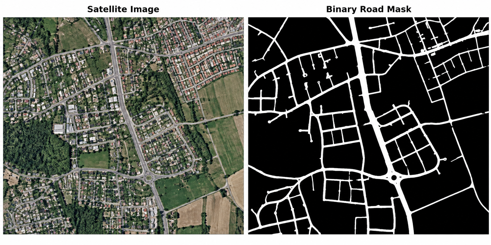
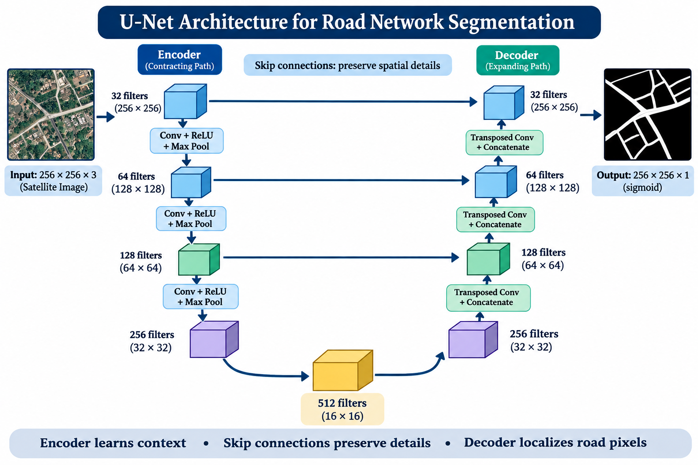

# Road Network Segmentation Using U-Net

A TensorFlow/Keras project for extracting road pixels from satellite imagery using a custom U-Net encoder–decoder network. The notebook uses the **DeepGlobe Road Extraction Dataset** and predicts a one-channel road segmentation mask for each input image.

## Table of Contents

- [Overview](#overview)
- [Why Road Network Segmentation Matters](#why-road-network-segmentation-matters)
- [Example: Image to Road Mask](#example-image-to-road-mask)
- [How It Works](#how-it-works)
- [U-Net Architecture](#u-net-architecture)
- [Dataset and Preprocessing](#dataset-and-preprocessing)
- [Training Configuration](#training-configuration)
- [Evaluation Metrics](#evaluation-metrics)
- [Requirements](#requirements)
- [Run the Notebook](#run-the-notebook)
- [Outputs](#outputs)

## Overview

Road network segmentation is a **binary semantic-segmentation** task: the model classifies each pixel in a satellite image as either road or background. Unlike image-level classification, which might only label an image as containing roads, segmentation identifies *where* the roads are at pixel level.

This project implements a custom U-Net using TensorFlow and Keras. The encoder learns increasingly abstract visual features, the decoder restores spatial resolution, and skip connections pass fine-grained information to the decoder to help localize road pixels.

### Project goals

- Load satellite images and their corresponding road masks.
- Preprocess image–mask pairs into a consistent size.
- Train a custom U-Net using binary cross-entropy loss and the Adam optimizer.
- Track accuracy, Dice coefficient, and intersection over union (IoU).
- Visualize input images, reference masks, and predicted road masks.
- Save the trained model in Keras format.

## Why Road Network Segmentation Matters

Roads are essential infrastructure, but manually tracing road networks from high-resolution satellite images can be slow and costly, especially across large or rapidly changing regions. Automated road segmentation can help turn raw imagery into structured geographic information that people and mapping systems can use.

Potential applications include:

- **Map creation and updating:** identify roads that are missing from existing maps or have changed over time.
- **Urban and regional planning:** analyze road coverage, settlement growth, and connectivity between communities.
- **Disaster response:** help assess road access and identify potentially usable routes after floods, earthquakes, or other emergencies. Results should be verified against current conditions before operational use.
- **Transportation and logistics:** provide road masks that can support later route-network analysis and infrastructure planning.
- **Remote and underserved areas:** assist mapping where up-to-date road data may be limited.

### Why is the problem technically challenging?

Roads can be narrow, winding, partially hidden by trees or buildings, and visually similar to rivers, rooftops, field boundaries, and shadows. A model must learn both the broader context of the scene and the fine details of road edges. It should also preserve road continuity: a mask with many gaps may be less useful for downstream network analysis even if many individual pixels are classified correctly.

The goal of this project is to learn a pixel-level representation of roads from labeled satellite images. The resulting mask is a useful intermediate output; turning it into a routable graph with road intersections and connections would require additional processing beyond segmentation.

## Example: Image to Road Mask

The following illustration shows the general input/output format of road segmentation. It is an explanatory illustration, **not a prediction produced by this project's trained model**.



- **Input image:** an RGB satellite image containing roads and surrounding land features.
- **Binary road mask:** road pixels are shown in white and background pixels in black.
- **Model output:** the network predicts a probability for each pixel; a threshold can convert these probabilities into a binary mask.

## How It Works

1. Read image and mask paths from the dataset metadata CSV.
2. Decode, normalize, center-crop, and resize image–mask pairs.
3. Create batched TensorFlow datasets.
4. Build and compile the U-Net model.
5. Train using Adam and binary cross-entropy.
6. Compare predictions with reference masks using segmentation metrics and visualizations.
7. Save the trained model as a `.keras` file.

## U-Net Architecture

U-Net is a convolutional encoder–decoder architecture originally introduced for biomedical image segmentation and now widely used for pixel-level segmentation tasks. Its shape resembles the letter **U**: a contracting path extracts context, and an expanding path restores spatial detail to produce a mask aligned with the input image.



*Architecture illustration for this project's custom U-Net. Feature-map sizes and filter counts are shown schematically.*

### 1. Encoder — contracting path

The encoder repeatedly applies convolutional layers and downsampling. In this implementation, each encoder block uses two 3 × 3 convolutions with ReLU activation, batch normalization, and dropout. Blocks before the bottleneck then apply 2 × 2 max pooling.

- **What it learns:** local edges and textures in early layers, then more complex patterns and scene context in deeper layers.
- **What downsampling does:** reduces feature-map width and height while the number of filters increases, allowing the network to represent more complex features.
- **Filter progression:** 32 → 64 → 128 → 256.

### 2. Bottleneck — deepest representation

The bottleneck sits between the encoder and decoder and uses 512 filters (`FILTERS * 16` when `FILTERS = 32`). It processes the most compressed feature map, combining information from a wider area of the image. In the configured architecture, the bottleneck does not apply another max-pooling operation.

### 3. Skip connections — preserving spatial detail

At each matching scale, a feature map from the encoder is concatenated with the upsampled feature map in the decoder. These **skip connections** help recover fine spatial information that may be lost during downsampling, such as road boundaries, narrow streets, and intersections.

### 4. Decoder — expanding path

The decoder upsamples feature maps using transposed convolutions, concatenates them with their matching encoder features, and applies convolutional layers. The spatial resolution increases as the number of filters decreases, allowing the model to localize roads in the original image.

- **Filter progression:** 256 → 128 → 64 → 32.
- **Main purpose:** combine high-level context with fine-grained spatial features to produce a detailed segmentation map.

### 5. Output layer

A final 1 × 1 convolution with one filter and sigmoid activation produces an output of shape `256 × 256 × 1`. Each pixel value represents the model's predicted probability of belonging to the road class. Applying a threshold such as `0.5` produces a binary road mask.

### Architecture summary

| Stage | Filters | Spatial size (for a 256 × 256 input) |
|---|---:|---:|
| Encoder 1 | 32 | 256 × 256 before pooling |
| Encoder 2 | 64 | 128 × 128 before pooling |
| Encoder 3 | 128 | 64 × 64 before pooling |
| Encoder 4 | 256 | 32 × 32 before pooling |
| Bottleneck | 512 | 16 × 16 |
| Decoder stages | 256 → 128 → 64 → 32 | 32 × 32 → 64 × 64 → 128 × 128 → 256 × 256 |
| Output | 1 | 256 × 256 × 1 |

## Dataset and Preprocessing

The notebook expects the **DeepGlobe Road Extraction Dataset** in a Kaggle-style input directory and reads a `metadata.csv` file. The metadata is expected to include `split`, `sat_image_path`, and `mask_path` columns.

Default paths configured in the notebook:

```python
ROOT_DIR = "/kaggle/input/deepglobe-road-extraction-dataset/"
METADATA_CSV_PATH = "/kaggle/input/deepglobe-road-extraction-dataset/metadata.csv"
```

Default image and mask dimensions:

- Satellite image: `256 × 256 × 3`
- Mask: `256 × 256 × 1`

The preprocessing function converts pixel values to floating point, takes a central crop using `ZOOM_FACTOR = 4.5`, resizes the crop to 256 × 256, and clips values to `[0, 1]`.

If running outside Kaggle, update `ROOT_DIR` and `METADATA_CSV_PATH` to match your dataset location. Confirm that the image and mask paths exist and correspond to one another.

## Training Configuration

The notebook's default configuration is:

| Parameter | Value |
|---|---:|
| Image size | 256 × 256 |
| Batch size | 32 |
| Base learning rate | 0.001 |
| Optimizer | Adam |
| Loss | Binary cross-entropy |
| Epochs | 100 |
| Base filter count | 32 |
| Random seed | 42 |
| Prediction threshold used for visualization | 0.5 |

The notebook also defines custom Dice and IoU metric functions. These metrics are computed during model evaluation; for a separate thresholded evaluation, apply a consistent threshold to predictions first.

## Evaluation Metrics

- **Pixel accuracy:** fraction of pixels classified correctly. It can be misleading when roads occupy a small fraction of the image.
- **Dice coefficient:** measures overlap between predicted and reference road masks; higher values indicate greater overlap.
- **Intersection over Union (IoU):** intersection area divided by the union of predicted and reference road pixels; higher values indicate greater overlap.

Use an independent held-out test set when reporting final results, and include the evaluation protocol alongside the scores.

## Requirements

The notebook uses Python with these main packages:

- TensorFlow (including `tf.keras`)
- NumPy
- pandas
- Matplotlib
- tqdm
- `tf-explain` (imported for Grad-CAM utilities)

Install the extra visualization dependency if needed:

```bash
pip install tf-explain
```

Install TensorFlow and the other packages using versions compatible with your Python environment. A GPU can help with training; actual runtime depends on hardware, dataset size, and configuration.

## Run the Notebook

1. Open `road_network_segmentation.ipynb` in Jupyter, Kaggle, or Google Colab.
2. Download the DeepGlobe Road Extraction Dataset from its authorized source and make it available to the runtime.
3. Update `ROOT_DIR` and `METADATA_CSV_PATH` in the configuration cell.
4. Verify the metadata columns and confirm that image and mask paths exist.
5. Run the notebook cells in order to load the data, build the model, train, visualize predictions, and save the model.
6. Before relying on evaluation numbers, verify that image/mask decoding is correct and that training, validation, and test samples are disjoint.

## Outputs

The notebook saves the trained model using:

```python
unet_model.save(MODEL_NAME + "-SIH-ZoomedData.keras")
```

With the default `MODEL_NAME = "SIH_T2"`, the output filename is:

```text
SIH_T2-SIH-ZoomedData.keras
```

Training history is held in `unet_model_history` during the notebook session. The visualization helper displays the original image, reference mask, overlay, predicted mask, and predicted overlay.
